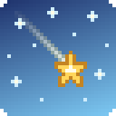
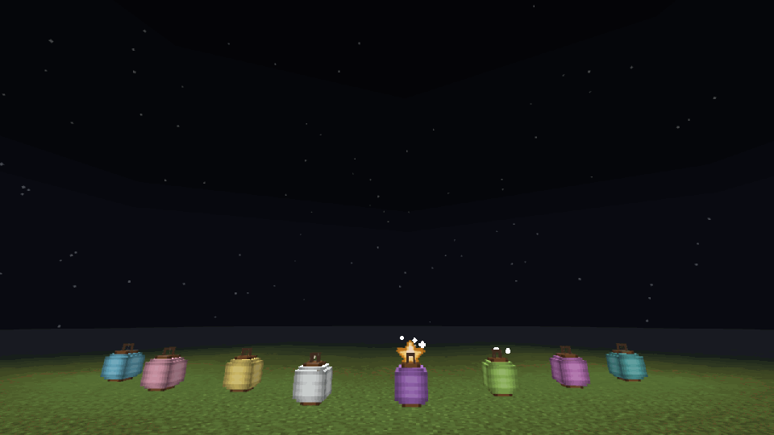
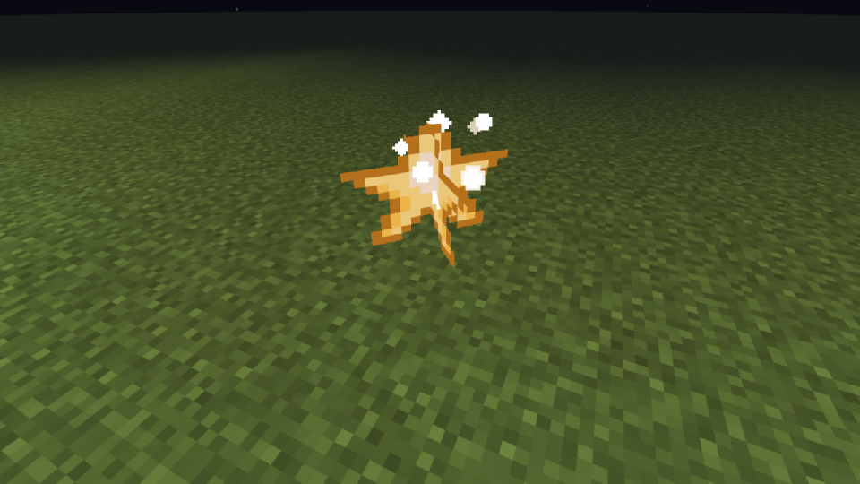
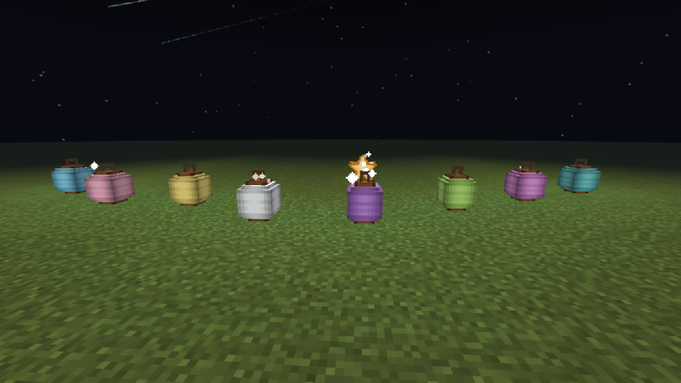
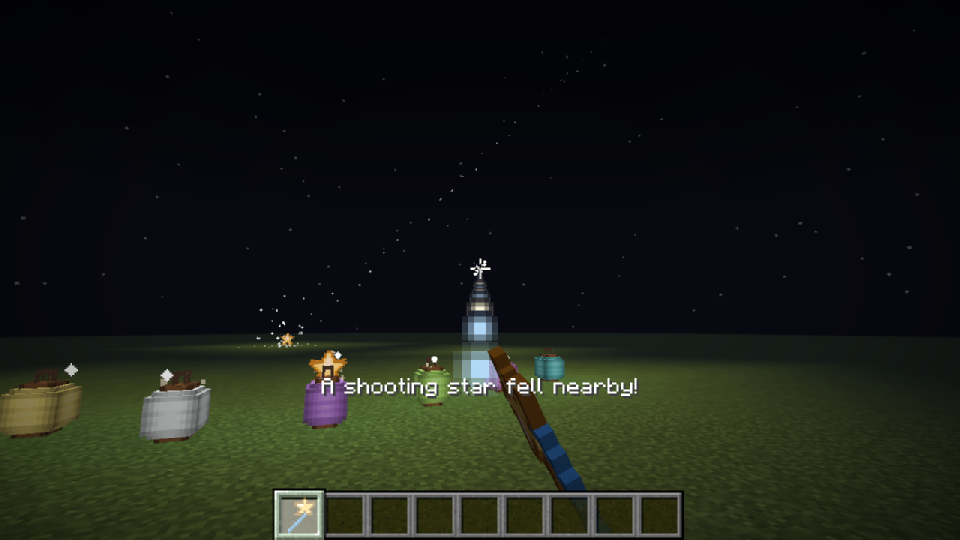

<p align="center"></p>

# Starfall

Algunas noches el cielo de Minecraft se llena de estrellas fugaces. Todas cruzan hacia el mismo lado, como una lluvia de verdad, y de vez en cuando una cae cerca de ti. Ve a buscarla: deja fragmentos de estrella con los que puedes hacer lámparas de papel de colores, bloques de cielo y una varita que ilumina.



Mod para **Fabric**. Esta rama es la versión para Minecraft **1.21.1** (la versión para 26.3 está en la rama [`main`](https://github.com/ccrccne/starfall)).

**Descarga:** [Modrinth](https://modrinth.com/mod/starfall-ccrccne) · [CurseForge](https://www.curseforge.com/minecraft/mc-mods/starfall-star-showers) · [GitHub Releases](https://github.com/ccrccne/starfall/releases)

## Índice
1. [Qué trae](#qué-trae)
2. [Recetas](#recetas)
3. [Comandos](#comandos)
4. [Instalación](#instalación)
5. [Con shaders](#con-shaders)
6. [Compilar desde el código](#compilar-desde-el-código)
7. [Preguntas frecuentes](#preguntas-frecuentes)

## Qué trae

### 🌠 Lluvia de estrellas
- Pasa más o menos **una de cada tres noches**. La primera noche de un mundo nuevo siempre hay una, para que la descubras pronto.
- Al empezar sale un aviso en el chat con una campanita: *"¡Esta noche hay lluvia de estrellas! Mira al cielo."*
- Las estrellas son estelas largas y finas que cruzan el cielo **todas en la misma dirección**. Cada lluvia tiene su propia dirección.
- Con lluvia (la del tiempo) no se ven, igual que las estrellas de verdad.
- Las estrellas del cielo son solo un efecto visual: no tocan el mundo ni gastan recursos del servidor.

### ⭐ Estrellas caídas
- Durante la lluvia, algunas estrellas **caen de verdad** cerca de los jugadores, más o menos una cada 45 segundos.
- Donde cae queda una **estrella caída** que brilla y suelta destellos. Al romperla da **2 a 4 fragmentos de estrella** (más con Fortuna).



### 🏮 Lámparas de papel
- Farolitos de papel que dan tanta luz como la piedra luminosa.
- Hay **16 colores**, uno por cada tinte de Minecraft.



### ✨ Varita estelar
- Lanza un rayo de destellos y deja una **lucecita flotante** donde apuntas (hasta 24 bloques). La luz dura un minuto y se apaga sola.
- Tiene 64 usos y se repara en el yunque con fragmentos de estrella.



### ☁️ Bloque de cielo
- Bloque decorativo azul cielo con estrellitas y un brillo suave.

Todo está en la pestaña **Starfall** del modo creativo, en español y en inglés.

## Recetas

| Resultado | Ingredientes |
|---|---|
| 2 lámparas de papel blancas | 4 papeles en cruz con 1 fragmento de estrella en el centro |
| Lámpara de otro color | Cualquier lámpara de papel + 1 tinte (sin forma) |
| 8 bloques de cielo | 8 hormigón azul claro alrededor de 1 fragmento de estrella |
| Varita estelar | 1 fragmento arriba a la derecha y 2 palos en diagonal (como una caña) |

## Comandos
Necesitan permisos de administrador (o trucos activados en un mundo de un jugador).

| Comando | Qué hace |
|---|---|
| `/starfall lluvia` | Salta a la próxima noche con lluvia de estrellas |
| `/starfall estrella` | Hace caer una estrella cerca de ti al instante |

## Instalación
1. Instala **[Fabric Loader](https://fabricmc.net/use/installer/)** para Minecraft 1.21.1.
2. Descarga **[Fabric API](https://modrinth.com/mod/fabric-api)** para la misma versión.
3. Descarga `starfall-1.0.0+1.21.1.jar` desde **[Modrinth](https://modrinth.com/mod/starfall-ccrccne)**, **[CurseForge](https://www.curseforge.com/minecraft/mc-mods/starfall-star-showers)** o **[Releases](https://github.com/ccrccne/starfall/releases)**.
4. Copia los dos `.jar` en la carpeta `mods` de tu Minecraft:
   - Windows: `%appdata%\.minecraft\mods`
   - macOS: `~/Library/Application Support/minecraft/mods`
   - Linux: `~/.minecraft/mods`
5. Abre el launcher, elige el perfil **fabric-loader** y juega.

En un servidor hay que instalar el mod también en el servidor para que caigan estrellas y existan las lámparas y la varita.

## Con shaders
El mod trae mapas de brillo en formato **labPBR**. Con **[Iris](https://modrinth.com/mod/iris)** y un pack de shaders compatible (por ejemplo Complementary o BSL), la estrella caída, los fragmentos, el papel de las lámparas y las estrellitas del bloque de cielo brillan con resplandor. Sin shaders se ven normales.

## Compilar desde el código
Necesitas **Java 21** o superior.
```bash
git clone -b mc1.21.1 https://github.com/ccrccne/starfall.git
cd starfall
./gradlew build
```
El `.jar` queda en `build/libs`. Para abrir un Minecraft de pruebas con el mod: `./gradlew runClient`.

Las capturas de este README son reales y están tomadas en la versión 26.3 (rama `main`), con una prueba automática que crea un mundo, monta la escena y fotografía la lluvia. En 1.21.1 el mod se ve igual.

## Preguntas frecuentes
- **No veo estrellas:** solo salen en las noches con lluvia de estrellas y con el cielo despejado. Prueba `/starfall lluvia`.
- **¿Funciona en otras versiones?** Hay versión para **26.3** y para **1.21.1**. Si quieres otra, abre un *issue*.
- **¿Funciona con otros mods?** Debería: no cambia nada de Minecraft, solo añade cosas.

## Licencia
[MIT](LICENSE). Hecho por **cancercocaine** (Discord) · [ccrccne](https://github.com/ccrccne) (GitHub) · [ccrccne.github.io](https://ccrccne.github.io)
